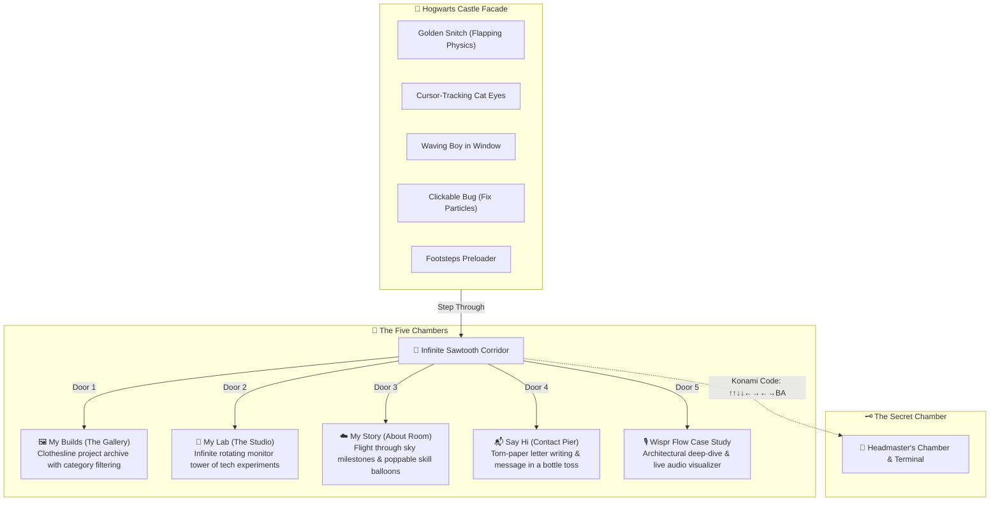

# 🏰 Harsh Karn | Interactive 3D WebGL Portfolio

<div align="center">

  
  
  
  
  
  

  <br/><br/>

  <p align="center">
    <strong>An enchanted, hand-drawn 3D sketchbook universe blending spatial WebGL computing with bespoke creative engineering.</strong>
  </p>

  <p align="center">
    <a href="https://harshkarn.dev"><strong>🌐 Explore Live Portfolio</strong></a> •
    <a href="https://github.com/Harsh-karn"><strong>💻 GitHub Profile</strong></a> •
    <a href="https://www.linkedin.com/in/harsh-karn--/"><strong>💼 LinkedIn</strong></a> •
    <a href="https://x.com/heyy_harsh_"><strong>🐦 Twitter / X</strong></a>
  </p>

</div>

---

## ✨ Overview

Welcome to the source repository for **Harsh Karn's** interactive 3D WebGL developer portfolio. Built as an homage to magical architectural sketchbooks and classic enchanted cartography, the application transports visitors through an infinite hand-drawn corridor populated with interactive spatial chambers, dynamic physics, positional audio, and hidden developer secrets.

Every visual element—from the Hogwarts-inspired stone facade to the paper-clipped case studies and floating message bottles—is rendered in a distinctive **pencil-sketch & parchment aesthetic**, powered by custom Three.js shaders and React Three Fiber.

---

## 🏛️ Spatial Architecture & The Five Destinations

The world is structured around an infinite corridor of angled portal doors, each leading into an autonomous, deeply interactive WebGL chamber:



### 1. 🖼️ My Builds (The Gallery)
- **Concept:** An enchanted open-air terrace where real engineering builds hang from wind-swept clotheslines on textured sketch paper cards.
- **Features:** 
  - Dynamic category filtering (`All`, `AI / ML`, `Full Stack`, `3D / Creative`).
  - Full-screen modal inspector with architectural breakdowns, technical highlights, GitHub links, and live deployment previews.
  - Background atmosphere: chimney smoke particle systems, moving construction cranes, and flocks of flying sketch birds.

### 2. 🧪 My Lab (The Studio)
- **Concept:** An infinite cylindrical tower of retro-futuristic CRT monitors suspended in space.
- **Features:**
  - 360° rotational inertia navigation and smooth scroll through tech experiments, UI sandboxes, and video demos.
  - Interactive monitor zoom on click with rich HTML modal overlays.

### 3. ☁️ My Story (The About Room)
- **Concept:** A first-person flight through rolling sketch clouds charting Harsh's journey as an Artist & Developer.
- **Features:**
  - Cloud milestones documenting education, career highlights, and international design accolades.
  - Interactive floating hot-air skill balloons: click to pop with realistic paper shard particles and reveal proficiency stats.
  - Hoverable avatar with camera swoop and speech bubble dialogues.

### 4. 📬 Say Hi (The Contact Pier)
- **Concept:** A serene wooden dock overlooking a sketch ocean with an island lighthouse on the horizon and rolling minimalist waves.
- **Features:**
  - Interactive torn-paper letter: live hand-drawn handwriting simulation as you type Email, Subject, and Message.
  - Send animation: the letter rolls into a glass bottle, is corked, and thrown into the sea with realistic splash ripples.
  - Interactive social media barrels with water bobbing physics.

### 5. 🎙️ Wispr Flow (Flagship Case Study)
- **Concept:** Dedicated spatial exhibition room dedicated to the Wispr Flow voice-to-text intelligence system.
- **Features:**
  - Live interactive Web Audio API frequency visualizer.
  - Deep-dive technical breakdown covering latency benchmarks, model quantization, and distributed speech pipelines.

---

## ⚡ 2026 High-Performance WebGL Engine

Rendering dozens of dynamic 3D elements, particle systems, and high-resolution sketch textures at a locked 60 FPS across all devices requires aggressive optimization:

| Technique | Implementation | Benefit |
|-----------|----------------|---------|
| **Asynchronous Shader Compilation** | `gl.compileAsync` via hidden `RoomWarmup` boundary during the preloader | Eliminates jank and frame drops when doors open |
| **Dynamic Device Tiering** | `PerformanceContext` auto-detects `navigator.deviceMemory`, CPU cores, and viewport | Dynamically switches between `HIGH`, `MED`, and `LOW` tiers (adjusting DPR, particle counts, and antialiasing) |
| **Baked Global Tinting** | Custom offline texture baking (`apply_global_tint.js`) | Replaces expensive real-time shadow maps and directional ray casting with zero-cost visual depth |
| **Direct DOM Mutation Bypassing** | Footsteps preloader & scroll counters write directly to `ref.current.style` | Bypasses React's `setState` reconciliation queue for 130+ concurrent asset streams |
| **Invisible Semantic SEO Engine** | `ScreenReaderOverlay` with `sr-only-seo` semantic DOM structure | Provides full accessibility and perfect Google search indexing without loading heavy WebGL canvases for crawlers |
| **B&W to Color Reveal Shader** | Custom `RevealMaterial` GLSL shader with alpha discard and noise thresholds | Creates smooth ink-wash color transitions on hover without swapping materials |

---

## 🗝️ Discoverable Easter Eggs & Secrets

The portfolio features an active **Achievements & Secrets Tracking System** with 7 discoverable secrets:

1. ☕ **Caffeine Boost:** Tap the steaming developer mug on the corridor desk to unleash rising sketch steam puffs.
2. 🚪 **Curious Seeker:** Find and rattle the miniature 404 Room door tucked into the corridor baseboard.
3. ✈️ **Ace Pilot:** Click the origami paper airplane to send it into a 3D loop-the-loop barrel roll.
4. 🧹 **Nimbus Rider:** Click the corridor broomstick to summon floating wizard particles.
5. 🌙 **Night Owl:** Press `B` on your keyboard to invert the sketchbook into **Blueprint Nocturnal Mode**.
6. 🎈 **Sharp Shooter:** Pop the floating skill balloons in the About sky chamber.
7. 📜 **Marauder Master:** Enter the legendary Konami Code (`↑` `↑` `↓` `↓` `←` `→` `←` `→` `B` `A`) to unlock the **Headmaster's Secret Chamber**!

---

## 🎧 Spatial Audio Architecture

Built with a centralized `AudioManager` and WebGL positional sound sources:
- **Corridor & Doors:** Wooden handle clicks, spatial door swings with stereo rolloff, and shuffling parchment footsteps.
- **The Rooms:** Flight wind whoosh in About, gentle sea surf on the Contact pier, and retro electronics hum in The Studio.
- **UI & Micro-interactions:** Paper rustling, balloon pops, bottle splash, and magical harp chimes.
- **Controls:** Master toggle, individual Music and SFX volume sliders, and auto-muting when tab loses visibility.

---

## 🛠️ Local Development & Setup

### Prerequisites
- **Node.js:** v20.0.0 or higher
- **npm:** v10.0.0 or higher

### Installation

1. **Clone the repository:**
   ```bash
   git clone https://github.com/Harsh-karn/portfolio.git
   cd portfolio
   ```

2. **Install dependencies:**
   ```bash
   npm install
   ```

3. **Configure Environment Variables (Optional):**
   Create a `.env` file in the root directory:
   ```env
   VITE_POSTHOG_KEY=your_posthog_key_here
   VITE_POSTHOG_HOST=https://us.i.posthog.com
   VITE_SANITY_PROJECT_ID=your_sanity_id_here
   VITE_SANITY_DATASET=production
   ```

4. **Start the local development server:**
   ```bash
   npm run dev
   ```
   Open your browser at `http://localhost:5173`.

5. **Build for production:**
   ```bash
   npm run build
   ```

6. **Preview the production bundle:**
   ```bash
   npm run preview
   ```

---

## 📁 Repository Structure

```
portfolio/
├── public/
│   ├── fonts/              # CabinSketch TTF fonts & Inter WOFF
│   ├── sounds/             # Spatial audio & sound effects (MP3/WAV)
│   ├── textures/           # WebP & PNG sketch assets
│   │   ├── corridor/       # Sawtooth walls, decorations, doors
│   │   ├── entrance/       # Castle wall, snitch, boy window, cat, bug
│   │   ├── gallery/        # Project sketch cards & background elements
│   │   ├── studio/         # CRT monitor textures & UI skins
│   │   └── contact/        # Torn paper form, bottles, barrels, sea
│   └── favicon.svg         # Golden snitch favicon
├── src/
│   ├── components/
│   │   ├── canvas/         # Three.js / R3F 3D components
│   │   │   ├── corridor/   # InfiniteCorridor, DoorSection, RoomWarmup
│   │   │   ├── entrance/   # Castle wall, EntranceDoors, SignSystem
│   │   │   ├── rooms/      # GalleryRoom, StudioRoom, AboutRoom, ContactRoom
│   │   │   └── Experience.jsx
│   │   ├── dom/            # Preloader, PaperTransition, HUD overlays
│   │   └── ui/             # NavigationUI, AchievementsPanel, KonamiSecretModal
│   ├── context/            # SceneContext, AudioManager, PerformanceContext, AchievementsContext
│   ├── hooks/              # useInfiniteCamera, useMouseParallax, useDocumentMeta
│   ├── shaders/            # Custom GLSL RevealMaterial & Noise shaders
│   ├── styles/             # Modular SCSS stylesheets
│   ├── App.jsx             # Canvas configuration & root experience flow
│   └── main.jsx            # Entry mount with custom console signature
└── package.json
```

---

## 📜 License & Copyright

The code in this repository is licensed under the [MIT License](LICENSE).

> **Note:** All custom 3D textures, hand-drawn vector artwork, sound designs, brand identity, and copywriting are copyright © 2026 **Harsh Karn**. All rights reserved.

---

<div align="center">
  Crafted with magic, code, and caffeine by <a href="https://harshkarn.dev"><strong>Harsh Karn</strong></a> ✨
</div>
